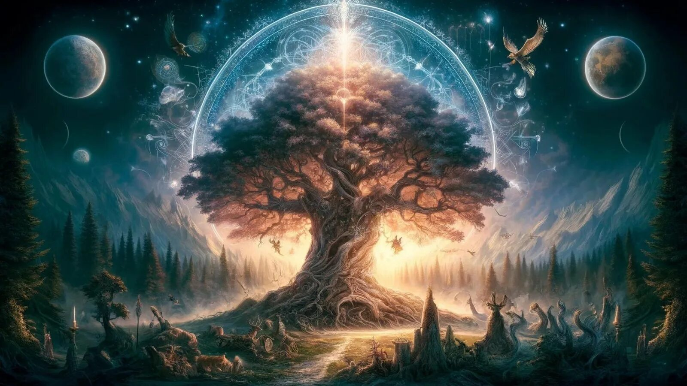

# 🌲 Scandic — Скандинавская Мифология

**Интерактивная энциклопедия скандинавской мифологии с полным родословным древом**



---

## 🌟 Особенности

- **233 HTML-страницы** — полная энциклопедия мифологии
- **46 персонажей** — подробные семейные древа
- **24 руны** — интерактивный каталог с значениями
- **9 миров** — космология Иггдрасиля
- **Эдды и Саги** — полные тексты источников
- **Современный дизайн** — тёмная тема "Вечный Север" с анимациями северного сияния

---

## 🚀 Быстрый старт

### Локальный просмотр

```bash
cd ~/Projects/scandic
python3 -m http.server 8000
```

Откройте: **http://localhost:8000**

### Деплой на GitHub Pages

1. Репозиторий: `olegvnovikov75/scandic`
2. Settings → Pages → Source: main branch, root
3. Сайт: `https://olegvnovikov75.github.io/scandic/`

---

## 📁 Структура

```
scandic/
├── index.html              ← Главная страница с Иггдрасилем
├── about.html              ← О проекте
├── contact.html            ← Контакты
├── gods.html               ← Каталог богов
├── literature.html         ← Источники и Эдды
├── myths.html              ← Мифы и саги
├── css/
│   ├── style-new.css      ← Основной дизайн (36KB)
│   └── style.css          ← Старые стили (сохранены)
├── js/
│   └── main.js            ← Интерактивность
├── images/                ← SVG и PNG изображения
├── family/                ← 46 семейных страниц
├── world/                 ← Страницы миров
├── runes/                 ← Страницы рун
├── texts/                 ← Эдды и саги
├── docs/                  ← Документация
└── scripts/               ← Python-скрипты
```

---

## 🎨 Дизайн

**Палитра "Вечный Север":**
- Фон: Глубокая ночь (#050810 → #1a2240)
- Акценты: Auric Gold (#d4a855), Aurora Green (#39ff8c)
- Шрифты: Cinzel, EB Garamond, IM Fell English

**Анимации:**
- Северное сияние (aurora borealis)
- Появление элементов при скролле
- Плавные переходы и hover-эффекты

---

## 📖 Разделы

### ⚡ Пантеоны
- **Асы** — Один, Тор, Фригг, Бальдр и др.
- **Ваны** — Фрейр, Фрейя, Ньёрд
- **Йотуны** — великаны, гиганты

### ❄️ Девять Миров
- Асгард, Мидгард, Ванахейм
- Йотунхейм, Нифльхейм, Муспельхейм
- Альфхейм, Свартальфхейм, Хельхейм

### ᚠ Руны Elder Futhark
24 руны с значениями и интерактивными модальными окнами

### 📜 Тексты
- Поэтическая Эдда (23 поэмы)
- Прозаическая Эдда (Гюльфагиннинг, Скальдскопармаль)
- Саги (Вельсунгов, Исландцев и др.)

---

## 🛠️ Технологии

- **HTML5** — семантическая разметка
- **CSS3** — переменные, анимации, flexbox/grid
- **JavaScript** — Intersection Observer, smooth scroll
- **SVG** — векторная графика для иконок

---

## 📚 Источники

- Поэтическая Эдда (пер. Беллоус, 1923)
- Прозаическая Эдда (Снорри Стурлусон)
- Сага о Вельсунгах
- Norse Mythology for Smart People

---

## 🤝 Вклад

Проект находится в активной разработке.Contributions welcome!

---

## 📄 Лицензия

Creative Commons — свободное использование с указанием авторства.

---

*Создано: 2026-07-10 · Обновлено: 2026-08-15*  
*Разработчик: Гаечка + Шеф 🧩*
